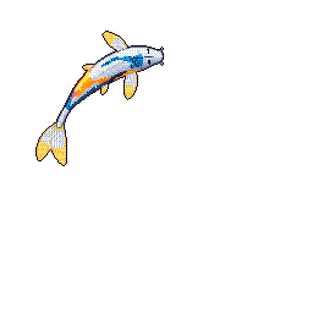

# 👋 Hi, I'm Ujwal Mojidra  

  

  

> I enjoy building systems where data makes decisions,
> models explain themselves, and code survives in production level.

  
✨ *Still learning. Still building. Occasionally refactoring life along with code.*
